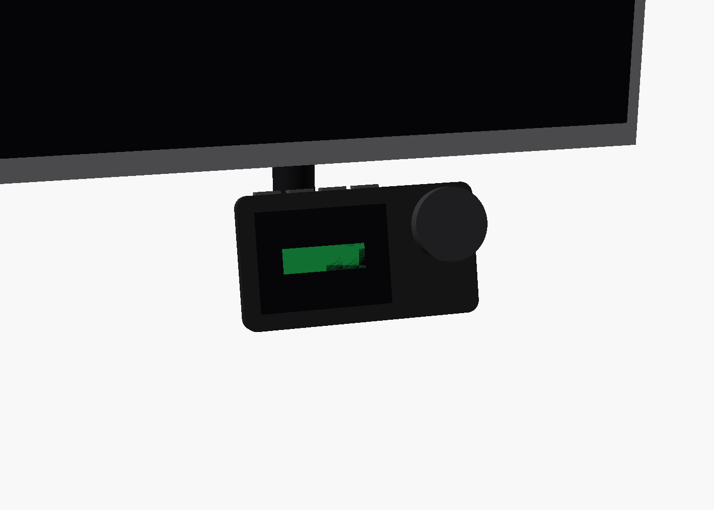
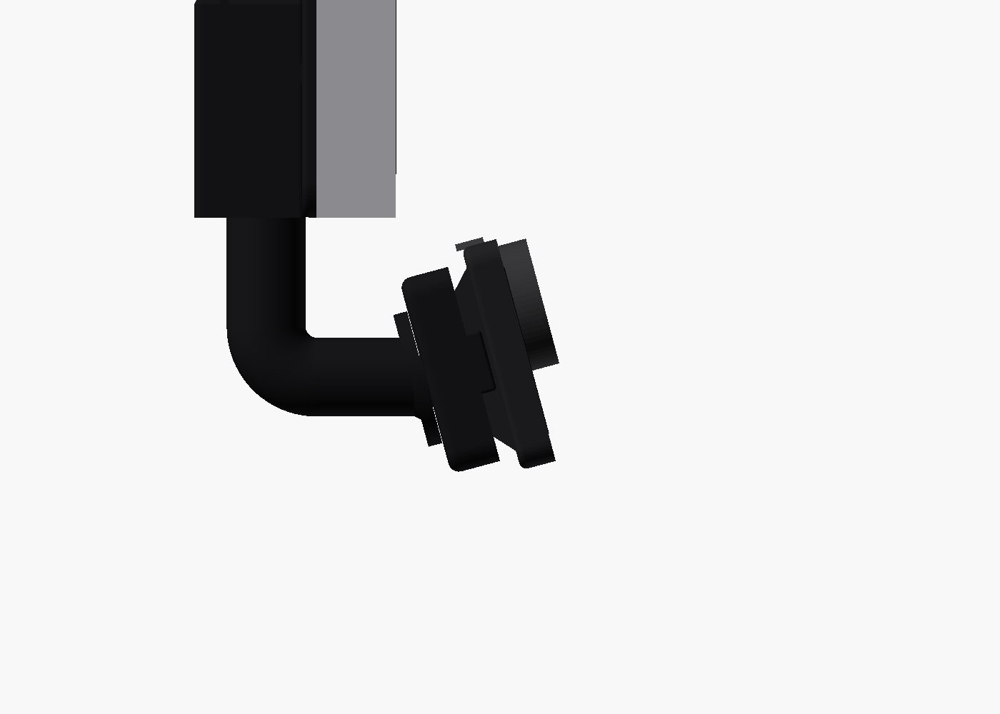
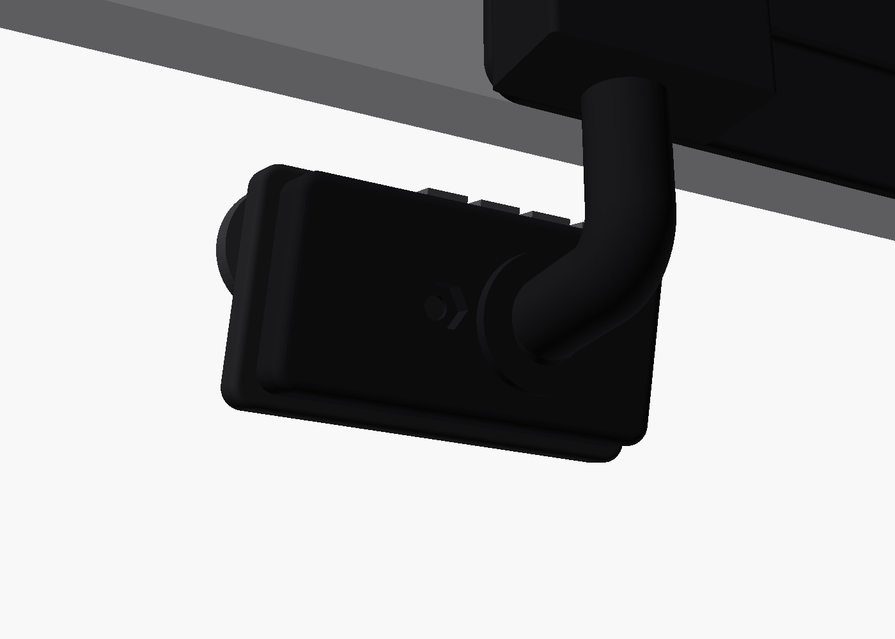

# Monitor mount

An adhesive mount for the back of the Kuycon G27P. From your seat you see the Car Thing and one round rod, nothing else. The rod comes down from behind the monitor, bends once behind the Car Thing, and runs into a backplate hidden behind it.

That backplate holds the Car Thing two ways:
- by the raised platform in the middle of its back, with a pot magnet;
- by its USB-C port, with a plug fixed in a block that sits over the thin tab end, beside the platform.

The cord runs inside the rod. Behind the monitor, a pocket holds the charge-through cable and the Wi-Fi dongle, and a shelf slot holds one USB device. A second, standalone shelf holds the other.

The mount prints as three parts, each lying the way it prints. The slicer adds supports where they're needed; the parts carry no built-in support shapes.
- the **plate**, which sticks to the monitor and carries the pocket and the shelf;
- the **rod**;
- the **dock**, the backplate behind the Car Thing.

They glue together at two keyed joints, both hidden: the rod's top goes up into a socket under the pocket, and a flange on its front end glues to the dock's back.

Each item stands in its slot ports-down, with its plugs passing through an opening in the floor. It rests on a narrow ledge either side of that opening and leans out against a 35 mm lip, since the monitor tilts back.

Designs:
- [docs/superpowers/specs/2026-11-05-mount-split-design.md](../../docs/superpowers/specs/2026-11-05-mount-split-design.md): the three parts and their joints
- [docs/superpowers/specs/2026-11-04-mount-redesign-design.md](../../docs/superpowers/specs/2026-11-04-mount-redesign-design.md)
- the original it builds on: [2026-11-03-monitor-mount-design.md](../../docs/superpowers/specs/2026-11-03-monitor-mount-design.md)

| Side | Behind |
|---|---|
|  |  |

> **The committed exports use placeholder dimensions.** Every line in `params.scad` marked `MEASURE` is a guess until you measure the real part. Measure, edit `params.scad`, run `./build.sh`, and print the coupons before the full parts.

## Measure first

These are read off photos or guessed. Each one changes the part:

- **Car Thing body:** `ct_w`, `ct_h`, `ct_t`, `ct_corner_r`.
- **The back's three zones, left to right from the front:** the thin tab end (`ct_thin_tab`), the raised platform (`ct_platform`) and the thin dial end (`ct_thin_dial`), and how far the thin ends sit below the platform (`ct_step`). The platform's ends curve down; the plug block assumes the port's wall is square where the block meets it.
- **The port:**
  - `ct_port_z`: its centre's height below the top edge;
  - `ct_port_y`: its centre's depth below the platform's surface;
  - `ct_port_depth`: how far a plug goes in.
- **The tab** past the tab end (`ct_tab`) and how far the dial overhangs its end (`ct_dial_overhang`).
- **The top row's end buttons** (`ct_end_buttons`), for the stiffness estimate.
- **The plug breakout:** `plug_w`, `plug_t`, `plug_len`, `plug_board`.
- **The cord:** `cord_d`, and the tightest bend it takes without force (`cord_bend_r`).
- **The pocket's contents:** `pocket`.
- **The shelf items' plugs:**
  - `item_plug_drop`: how far they stick out below the item, to where the cable can bend. It sets how high each slot sits.
  - `item_plug_t`: how thick they are across the item. They pass through a 12.5 mm opening between the ledges.
- **Your seat:**
  - `eye`: distance from the screen and height above its bottom edge;
  - `mount_x`: how far right of the monitor's centre the Car Thing sits;
  - `desk_clear`: the desk's distance below the monitor's bottom edge.

## Files

| File | What |
|---|---|
| `params.scad` | Every dimension. Edit this, nothing else, to fit your parts. |
| `main-mount.scad` | The three parts: `part = "plate"`, `"rod"` or `"dock"`, each lying as it prints. Also the test renders. |
| `standalone-shelf.scad` | A plate and one shelf slot, standing on its end as it prints |
| `coupons.scad` | Test prints: `magnet`, `slot`, `socket` |
| `lib/joint.scad` | The two glued joints |
| `preview.scad` | The mount with a stand-in Car Thing and monitor, for renders only |
| `checks.scad` | The design's rules, as asserts |
| `stl/`, `step/`, `renders/` | Outputs of `./build.sh`. STEP is rebuilt from the mesh, so its curves are faceted. |

`test/mount.test.sh` checks these rules:
- **Hidden from your seat:** the backplate, the plug block and the rod's forward run.
- **Magnet:** it sits on the raised platform, with no plastic over its face.
- **Plug block:** it clears the thin end's surface, and stays inside the Car Thing's outline.
- **Rod to dock:** the rod meets the dock behind the plug board (`joint_x`), so the wires run straight in, and its peg hole clears the magnet's nut.
- **Stiffness:** a 5 N press on the end button moves the Car Thing at most 0.14 mm (beam estimate, `lib/stiffness.scad`). The rod meets the Car Thing off-centre, so the far button has more leverage than when it was centred.
- **Button access:** a fingertip on the top buttons clears the monitor.
- **Placement:** the Car Thing stays below the bezel, out of your line of sight to the screen, and above the desk.
- **Cord:** it never bends tighter than `cord_bend_r`, and never breaks out of the part or into the magnet seat.
- **Shelves:**
  - an item standing ports-down, with its plugs below it, touches nothing;
  - its plugs end above the monitor's bottom edge;
  - the lip reaches past the item's middle, and the item's top stays clear to grab.
- **Joints:**
  - the rod's socket is at least as deep as the rod is wide, with 3 mm of wall all round;
  - the flange is at least 12 mm wider than the rod, and hidden from your seat;
  - assembled, the three parts don't overlap anywhere, and none of them blocks the cord channel.
- **Handedness:** the printed part is not a mirror image.
- **Printability:** every part is one closed solid that fits the MK4.

It also checks that the rules catch:
- thin ends too shallow for the plug block;
- the rod meeting the dock over the magnet;
- a seat that's far off to the side;
- a Car Thing pulled back under the monitor;
- the old 7 mm lip;
- plugs hanging below the monitor;
- ledges too narrow to hold an item;
- a shallow socket;
- a narrow flange.

It needs OpenSCAD (`brew install --cask openscad@snapshot`) and Python 3. `./build.sh` also needs FreeCAD (`brew install --cask freecad`).

## Print

Matte black PETG, 0.2 mm layers, 4 walls, 40% gyroid. Every STL is already lying the way it prints: load it as it is and add a brim. Turn supports on, **on build plate only**, so the slicer doesn't fill the cord channel or the socket, which are shaped to print without them.

- **Coupons first.**
  - **`magnet`:** the magnet seats flush, the cut stud and nut tighten, and the magnet face stays bare.
  - **`slot`:** a short slot with room for one plug. Stand the hub in it ports-down, with one plug through the opening.
    - The plug passes through without touching the ledges.
    - The hub rests on both ledges, not on the plug.
    - The hub leans against the lip and can't tip out.
  - **`socket`:** a block with the rod's socket, and a stub of the rod's top end.
    - The stub slides in by hand, with a little room for glue.
    - It only goes in one way, flat side to flat side.
  - Adjust the `MEASURE` values until all three pass.
- **Dock:** it lies on its back, with the magnet pocket and the plug block facing up.
  - The roof of the plug board's pocket bridges about 16 mm. Clear any sag inside before sliding the board in.
  - Try it on the real Car Thing before gluing anything (see Assembly).
- **Rod:** it stands as it hangs, on the flange's lowest edge.
  - The part you see prints as a vertical cylinder: round layers, with nothing touching it.
  - Put the slicer's seam on its back, the side facing away from you when mounted.
  - The slicer supports the bend, the forward run and the flange from underneath. All three are hidden behind the Car Thing, so support marks there don't show.
- **Plate:** it stands on its bottom edge, as it hangs on the monitor. The slicer supports the shelf's floor and the pocket's open face; the pocket sits on a solid base, which holds the rod's socket.
- **Standalone shelf:** it stands on one end of its slot.

## Parts

- Magnetpro pot magnet, 43 mm, with a 1/4"-20 stud, and one 1/4-20 hex nut.
- A USB-C **plug** breakout carrying VBUS, GND, D+, D− and CC (not a power-only one), for the dock.
- A USB-C **female (receptacle)** breakout carrying the same five, for the pocket. The charge-through cable plugs into it, so no cable gets cut.
- The charge-through USB-C cable, a USB-C male to USB-A female adapter, and the Wi-Fi dongle. Check that the dongle is the Wi-Fi model, not the UB500 Bluetooth one.
- Five thin wires for the rod: 26–28 AWG silicone, about 40 cm each (VBUS, GND, D+, D−, CC). Loose wires thread far more easily than a jacketed cable; twist D+ and D− together.
- A pull line to thread them: 1.5–2 mm nylon trimmer line, about 40 cm.
- 3M VHB tape, enough to cover the back of both plates.
- A two-part epoxy for plastics (for example Loctite Epoxy Plastic Bonder), for the two glued joints and to pot the plug board.

## Assembly

1. **Dock:**
   - Cut the magnet's stud to **7.8 mm** (`stud_cut()`).
   - Drop the nut into the hex pocket on the dock's back. The pocket stops it turning.
   - Screw the magnet's stud into the nut from the front, until the magnet sits flush in its pocket.
   - **Try the dock alone on the Car Thing.**
     - The block sits over the thin tab end without touching it.
     - The Car Thing slides toward its tab end until the port wall meets the block's shoulder.
     - It slides back toward the dial far enough to unplug.
     - Seated, press each top button firmly (about 0.5 kg) and turn the knob hard. The Car Thing must not slip on the magnet.
2. **Wires and plug:**
   - Wire the breakout as in [docs/hardware/pogo-dock.md](../../docs/hardware/pogo-dock.md): VBUS, GND, D+, D− and CC, with the breakout's CC resistor removed.
   - Thread the five wires through the loose rod, in at its top end and out through the spigot on its flange. Use the pull line if they snag at the bend.
   - Feed their ends into the dock's spigot hole and on into the board pocket.
   - Solder them to the plug board.
   - Slide the board into the block from its open bottom until the plug comes through the shoulder.
   - Check continuity.
3. **Rod to dock:**
   - Scuff the flange's face and the dock's back with sandpaper, and dry-fit them. The teardrop spigot only goes in one way, point down.
   - Glue the flange and spigot to the dock, keeping glue out of the spigot's end so the channel stays clear.
   - Let it cure.
   - **Then pot the board without gluing the plug.** The spigot now plugs the channel, so the epoxy can't run out through it.
     - Turn the dock so the block's open bottom faces up.
     - Mask the plug's shell where it leaves the shoulder.
     - Fill the board pocket with a thick (gel) epoxy, stopping short of the shoulder slot, so nothing wicks along the plug.
4. **Rod to plate:** the socket's mouth is only about 6 mm above where the rod comes into view, so keep the glue inside.
   - Feed the wires' top ends up through the socket and into the pocket.
   - Scuff only the rod's D-shaped end, not the round part below it, and dry-fit it, flat side toward the plate.
   - Wrap masking tape round the rod just below the D-shaped end.
   - Turn the plate upside down, rod end up, so any excess runs back into the socket rather than down the rod.
   - Glue the D-shaped end sparingly, keeping glue off its tip and out of the cone at the socket's top, and push it home.
   - Wipe off any squeeze-out at once, then peel the tape.
   - **Let it cure 24 h,** still upside down, before loading it.
5. **Pocket:**
   - Solder the wires' other ends to the female breakout, matching VBUS, GND, D+, D− and CC. Remove its CC resistor too (see pogo-dock.md).
   - Plug the charge-through cable's Car Thing end into it.
   - Put the dongle, on its C-to-A adapter, at the pocket's open face, away from the monitor's metal back.
   - The power cable lays into the notch at the top of the pocket's side wall.
6. **Mount:**
   - Stick the main mount on the **right half** of the monitor's back, clear of the stand and any vents. Its bottom edge goes on the monitor's bottom edge, with the rod hanging below.
   - Clean the back with isopropyl alcohol, apply the VHB, and press for 30 s.
   - **Wait 24 h before hanging anything on it.**
   - Stick the standalone shelf wherever suits.
   - After the 24 h, stand each item in its slot ports-down, with its plugs through the opening.
7. **Car Thing on:**
   - Hold it against the magnet at least **6 mm** toward the dial end, which is its right end as you face it. That's the plug's 5.3 mm (`dock_engaged()`) plus clearance. Any less and the magnet snaps the platform down onto the plug's tip.
   - Slide it toward the tab end (left) until it stops. The plug is then fully seated.
8. **Car Thing off:**
   - Slide it toward the dial end (right) until it unplugs.
   - Tip the tab end away from the backplate and lift it off.

## Checks after mounting

- Press every button and turn the knob: nothing moves.
- Take the Car Thing off and put it back 10 times.
- Hang about 300 g on each shelf for 48 h: no peel or creep.
- The Car Thing boots on the plug, and `ip link` on it shows `wlan0`.
